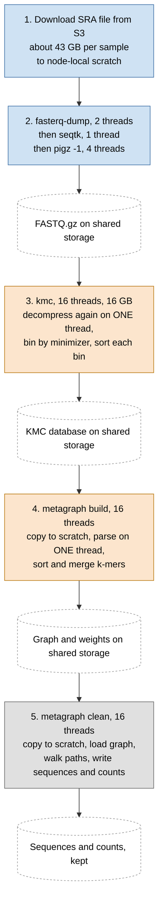
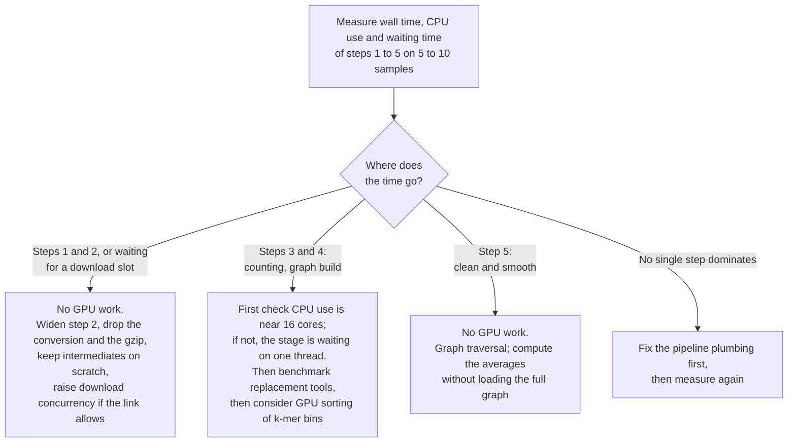
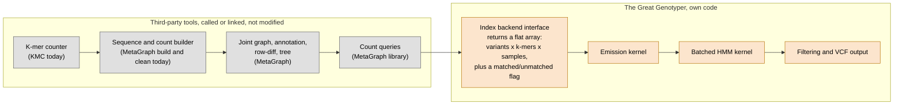

# The Great Genotyper — Enhancement Report and Plan

Review of the repository at commit `7814b14` (`master`), carried out 26–27 November 2026.

## How to read this report

- **Method.** The code was read, cross-checked against the published manuscript and against upstream MetaGraph, and then validated: the project was built, a small index was constructed from simulated data, and the genotyper was run on it. Section 17 records what was run.
- **Confidence labels**, from weakest to strongest:
  - **[unverified]** — a suspicion that needs a test or deeper reading before acting.
  - **[reported]** — found in a first-pass review and cited with file and line, but not re-read a second time.
  - **[checked]** — the code was re-read independently and the finding confirmed.
  - **[observed]** — reproduced in an actual build or run.
- **Scale of the runs.** The validation data is small: 0.5 to 5 Mb of chromosome 21, 4 to 8 simulated samples, error-free reads. It shows whether something happens, not how long it takes at 4.2K samples. Timings from it are labelled indicative.
- **Own code and third-party code are reported separately.** "Own code" is what was written or modified for The Great Genotyper: `pangenie/src`, `PopMergeVCF`, `DatabaseBuilder`, the workflows, the helper scripts, the build files and the three commands added to MetaGraph. Part A covers it. Part B covers third-party code: MetaGraph, KMC, Jellyfish, Beagle, the QC tools and the VCF utilities.
- **Paths** are relative to the repository root. In Part A, `src/` means `pangenie/src/`. In Part B, MetaGraph paths are relative to the top-level `src/`.
- **Manuscript.** Shokrof, Abuelanin, Brown and Mansour, "The Great Genotyper: a graph-based method for population genotyping of small and structural variants", GigaScience 2025, doi:10.1093/gigascience/giaf112.
- **Questions for the corresponding author** are collected in section 16.

## Contents

1. Summary
2. Context from the manuscript

**Part A — The Great Genotyper's own code**

3. Potential bugs
4. Command-line interface
5. Workflows and scripts
6. Build, tests and CI
7. Documentation and repository hygiene
8. Code quality
9. Genotyper performance

**Part B — Third-party code**

10. Third-party components

**Part C — Analysis**

11. Index construction: where the time may go
12. Parallel models: many nodes, MPI and OpenMP
13. GPU suitability
14. Separating The Great Genotyper from MetaGraph

**Part D — Actions**

15. Plan
16. Questions for the corresponding author
17. Validation record
18. Easy misreadings of this codebase

## 1. Summary

The repository is a fork of MetaGraph with a modified PanGenie embedded under `pangenie/`, plus about a dozen pipeline directories. Of 8,567 tracked files, roughly 7,500 are vendored third-party libraries.

1. **Potential bugs were found and reproduced on simulated test data.** The most consequential is in the k-mer-only workflow: statistics for variants within 30 bp of each other can be read from the wrong positions, which blanked about 9% of genotypes in the test data. In addition, the emissions file is read back misaligned, loading saved emissions aborts or crashes, and the merge-and-filter tool carries state over between variants (section 3).
2. **The two implementations of the population filter use different rules.** The genotyper uses the median across samples. The tool used by the full-index workflow uses the lower quartile within each genotype class (section 3.1, C6).
3. **A sample can potentially be treated as having zero counts without notice.** The count query drops any sample matching fewer than 10% of a sequence's k-mers, and the genotyper reads the missing entry as a true zero (section 3.1, C7).
4. **Nothing guards against regressions.** The unit tests are disabled and no longer compile, and no CI job builds the code (section 6).
5. **The published workflows do not run as committed**, and the index pipeline's defaults differ from the manuscript (section 5).
6. **The documented build fails on a current toolchain** and the README's genotyping command needs 17 GB for one hash table. Both have simple workarounds (sections 6 and 9.4).
7. **The HMM workflow works and is accurate on test data once those are worked around**: 99.97% of called genotypes matched the simulated truth, and thread scaling from 1 to 4 threads was close to linear (section 9).
8. **What limited index construction is unknown**, and it decides the value of GPU work there. Single-threaded decompression and parsing is the best-supported suspect (section 11.3).
9. **GPU acceleration is clearly worthwhile in one place**: the genotyping HMM. An imputation engine would not share its kernel with that HMM, because Beagle's model is structurally different (sections 13 and 10.6).
10. **MPI is not the right tool for scaling out, and OpenMP is already in use** (section 12).
11. **The genotyper can be separated from MetaGraph cheaply**, but upgrading to current MetaGraph needs a small adapter because the count-query interface changed (section 14).
12. **Code quality needs routine work**: a 488-line `main`, a class with four jobs, about 290 lines of commented-out code, 273 unreachable lines, three copies of one file, and no formatter or linter configuration (section 8).
13. **Several things in this codebase look like problems, or like easy wins, and are not.** Section 18 lists them so they are not rediscovered.

## 2. Context from the manuscript

### 2.1 Reported costs

| Step | Reported resources | Approximate core-hours |
|---|---|---|
| Per-sample preprocessing (download, k-mer counting, unitigs) | 21 days on 16 nodes of 16 cores and 20 GB; about 2 hours per sample | 129,000 |
| Building the 29 sub-indexes | 10 days on four 32-core, 200 GB servers; about 35 hours for 150 samples | 31,000 |
| Genotyping 4.5M variants in all 4.2K samples | 100 hours on 32 cores, 145 GB | 3,200 |

The core-hour column is arithmetic from the reported figures. The input was 183 TB for 4,271 samples; the index is 867 GB in 29 sub-indexes of 16 to 68 GB.

### 2.2 Design statements that affect this review

- **The population filter uses the median.** Genotypes "falling below this median are discarded" per variant and later re-imputed by Beagle.
- **Counts are smoothed, not log-scaled.** Each k-mer carries the average count of its unitig. Log scaling and graph cleaning were rejected because they reduced accuracy at low coverage.
- **Sub-indexes are the scaling unit.** They are meant to be built and genotyped independently and combined afterwards.
- **Emissions on disk and an aggregation step are described features.**
- **`pangenome_genotyping/` is a published entry point**, cited as the general-purpose workflow for the HPRC pangenome.
- **Two imputation models is a stated limitation.** The authors write that a unified model for the k-mers in the index "could both enhance the accuracy and boost the performance".
- **"Operating system(s): Platform independent"** is stated in the availability section.

### 2.3 What the manuscript does not provide

- No per-stage breakdown of genotyping time.
- No split of the two hours of per-sample preprocessing.
- No software versions for MetaGraph, KMC or Beagle.
- No commands for the QC and partitioning step.

---

## Part A — The Great Genotyper's own code

## 3. Potential bugs

Every item in this section is a potential bug: behaviour seen in the code, or on small simulated data, that looks unintended. Whether each one matters in practice, and what the intended behaviour is, is for the authors to confirm.

### 3.1 High severity

| # | Finding | Location | Status |
|---|---|---|---|
| C1 | **Emissions file is read back misaligned.** The sample count is written as 4 bytes and read as 8. A normal run continues silently, because the extra 4 bytes are usually zero. Two failure modes were reproduced: a flag in the first four samples of the first variant aborts with "file is corrupted"; a flag anywhere else is shifted by 4 bytes, and in the test this changed 9 output lines. | `src/emissionprobabilitycomputer.cpp:216`, `:246-247` | [observed] |
| C2 | **`-x` (load emissions) does not work.** It aborts with "Failed to open file", because the path is built from the empty save prefix. With the file placed at that path, it crashes in the output writer, because per-sample statistics are only filled during computation. It also overwrites the path-segments file. | `src/pggtyper.cpp:455`, `:486`; `src/variantreader.cpp:608`, `:633` | [observed] |
| C3 | **PopMergeVCF leaks state between variants.** It clears copies of its quality vectors, so each variant's threshold is computed over all earlier lines. One test line gave `0/1` when run alone and `./.` after 13 earlier lines. Over a whole file, 576 genotypes were blanked against 556 when each line was processed alone. Memory and sorting cost also grow with every line. Under the workflow's 10 MB block split, the result depends on where the blocks fall. | `PopMergeVCF/PopMergeVCF.cpp:27-30`, `:61-65`. Fix and regression test: branch `AAA/fix-popmerge-state`. | [observed] |
| C4 | **Per-sample statistics are mis-indexed for clustered variants, which can blank genotypes in the k-mer-only workflow.** Variants closer than 30 bp are handled as one cluster. Their statistics are stored in blocks sized by the cluster's allele count but read back using the single variant's allele count. In the test data, 1,185 of 1,420 clustered sample-records had wrong KC, UK or AK values. In `-a` mode, which blanks a genotype when its unique-k-mer count reads as zero, 506 of 5,720 genotypes were set to `./.` on that basis; a corrected reader recovered them, and 503 matched the truth. Concordance over all genotypes rose from 0.9075 to 0.9955 (0.9201 to 0.9916 on the larger data). The HMM workflow is affected the same way only with `-u`; without it, genotypes are unchanged and only the KC, UK and AK fields are wrong. When a cluster has fewer alleles than one of its variants, the reader runs past the end of the array; Valgrind reported the invalid read and the VCF showed garbage values. | `src/variantreader.cpp:606-607`, `:631-632` (reader) vs `:306-320` (writer). Fix and regression tests: branch `AAA/fix-cluster-stats`. | [observed] |
| C5 | **A chromosome with no usable variants aborts the run.** Listed last, the run aborted after the previous chromosome and left the output VCF truncated at 1,356 of 1,430 records. Listed first, it aborted with "file is corrupted". | `src/variantreader.cpp:167-168`; `src/transitionprobabilitycomputer.cpp:105` | [observed] |
| C6 | **The population filter is implemented twice with different rules.** The genotyper uses the median GQ across all samples (`quals[size/2]`). PopMergeVCF, which the full-index workflow uses, takes the lower quartile within each genotype class (`q.second[size/4]`). | `src/variantreader.cpp:622-623`; `PopMergeVCF/PopMergeVCF.cpp:61-65` | [checked] |
| C7 | **A sample can silently read as zero counts.** The count query is called with a discovery fraction of 0.1, so a sample matching under 10% of a sequence's k-mers is removed from the result. The genotyper then looks its counts up with `operator[]`, which returns 0, indistinguishable from true absence. | `src/SamplesDatabase.cpp:75`; `src/uniquekmercomputer.cpp:171`, `:261` | [checked] |

### 3.2 Medium severity

- **Coverage-peak detection can report the wrong peak.** `largest` is updated without `largest_id`. It bites only when the highest peak is the third or later one found. The same block is copied in three places (`DatabaseBuilder/computeHistogram.cpp:88-91`, `src/jellyfishcounter.cpp:160-163`, `src/cli/addCount.cpp:103-141`). [checked]
- **Empty index list crashes.** An empty `-i` file gives a segmentation fault (`src/pggtyper.cpp:315`). [observed]
- **Non-numeric option values abort.** `-t abc` ends in an uncaught `stoi` exception. [observed]
- **VCF output.**
  - The header declares GL, KC, UK and AK even when they are not written; they appear only with `-w`. [observed]
  - No `##contig` header lines; `bcftools` warns but reads the file. [observed]
  - For alternative alleles carried by no panel haplotype, `AK` prints 65535 and `GL` prints `-inf`. [observed on crafted input]
  - KC is declared Float but stored as an integer. [reported]
  - PopMergeVCF passes FORMAT through unchanged while emitting only `GT:GQ`. [observed]
- **Combining path subsets depends on job order.** The first subset to finish is normalised; later ones are added raw and renormalised (`src/pggtyper.cpp:98-112`). Output could therefore differ between runs when more than one subset is used. The test panel was small enough to need one subset, so this was not exercised; outputs there were byte-identical across thread counts. [checked]
- **Transitions ignore skipped columns and subset size.** The transition table gives the distance to the next variant, not to the next column actually used by a subset, and is built with the full panel's path count, not the subset size (`src/transitionprobabilitycomputer.cpp:111-118`, `:169-174`). Whether this is intended is question 17. [checked]
- **Exceptions inside parallel regions terminate the program.** This applies to the thread pool (`src/threadpool.cpp:46`) and to throws inside the OpenMP emission loop (`src/SamplesDatabase.cpp:99`, `:104`). [checked]
- **Stage timings printed at the end are unreliable.** "Reading input files" showed 0.000016 s, and the total exceeded wall-clock time. Two timers are also uninitialised. [observed]
- **Undefined behaviour.** `TransitionProbability` has no virtual destructor but is deleted through a base pointer. [reported]
- **Unchecked files.** The sample description file and the output file are opened without checks; a failed emissions save only prints. [reported]
- **Memory ownership.** Six allocation sites have no matching release on every path (section 8.3). [checked]
- **Temporary file collisions.** The path-segments file is named from the emissions prefix, is never deleted, and is overwritten by a later run with the same prefix. [checked]

### 3.3 Low severity

- `src/pggtyper.cpp:237-238`: `only_genotyping = false` is written twice; the second was presumably meant to be `only_phasing`. [checked]
- `src/uniquekmercomputer.cpp:13`: a static k-mer size is rewritten from several threads with the same value. ThreadSanitizer flags it; it is harmless as written. [observed]
- `src/copynumber.cpp:44-53`: `operator==` pushes onto the wrong vector. [reported]
- `src/transitionprobabilitycomputer.cpp:146`: a shadowed variable makes the unphased branch return 0. [reported]
- `src/SamplesDatabase.cpp:109`: `1 << counts[i]` overflows for counts of 31 or more, in log-scale mode, which the published index does not use. [reported]
- `src/uniquekmercomputer.cpp:275`: integer division when computing coverage. [reported]
- `src/pathsampler.cpp:97-101`: `random_shuffle` (removed in C++17); the last subset may hold duplicate paths. [checked]
- `src/fastareader.cpp:31-33`, `src/variantreader.cpp:123`: `substr` can throw on short or malformed input. [reported]
- `src/pggtyper.cpp:316`: k-mer size is taken from the first database only. [reported]

## 4. Command-line interface

All in `src/pggtyper.cpp` unless noted.

- **Unknown options are silently ignored.** `-Z foo` ran normally with identical output. [observed]
- **Inactive options.** `-g` and `-p` are no-ops; Viterbi phasing is commented out. `-q` and `-c` are read and unused. `-s` is read but never registered. `-m` prints "Loading" but recomputes. `-u` is overridden in `-a` mode. [checked]
- **Help text is wrong.**
  - The usage line says `-i <reads.fa/fq>`; it is a text file of index folder prefixes. [checked]
  - Each prefix needs a trailing `/`; without it the graph path is built wrongly and loading fails. [observed]
  - `-o` is described as a prefix but is an exact filename, or `-` for stdout.
  - Exactly one of `-x`/`-y` is mandatory, but both are documented as optional. [checked]
- **Option letters have no mnemonics.** `-f` disables the population filter, `-a` means emissions only, `-w` adds extra fields. Long options would help (section 8.1).
- **No `--version`.**
- **Model constants are hard-coded**: recombination rate 1.26, effective population size 0.00001, subset size 14, a cap of 301 k-mers per variant.
- **Debug output is unconditional**, including a dump of the path subsets to stderr.

## 5. Workflows and scripts

### 5.1 Genotyping workflows

**`runWorkflow/Snakefile`** (advertised in the README):

- Binary paths are hard-coded to `/home/mshokrof/TheGreatGenotyper/build6/...` (`:89`, `:132`). [checked]
- Chunks are hard-coded as `range(1,31)` while the index has 29 sub-indexes (`:114`, `:142`). [checked]
- Two rules expand `{output}` to two files inside `mv`, `tabix` and `bgzip` commands (`:133-134`, `:214-215`), so `mv` fails. [checked]
- The `.tbi` written by the genotyping rule is not a declared output, yet the merge needs it. [checked]
- The README says `--use-conda`, but no rule has a `conda:` directive; `envs.yaml` is an unrelated environment with no Java, `bgzip` or `parallel`. [checked]
- One SLURM partition and 600 GB are hard-coded; a resource is misspelled `meduim`; there is no config validation.
- **`gp=true` has no effect.** With genotypes only and no reference panel, Beagle writes `GT` alone, so no probabilities are emitted and the genotyper's GQ is dropped from the final output (section 10.6). [checked against Beagle's source]
- **`bcftools merge --threads` has no effect** where it is used, because the output is uncompressed and piped to single-threaded `bgzip` (section 10.8). [checked]

**`pangenome_genotyping/Snakefile`** (cited in the manuscript):

- Rule `merge_population_chunks` is defined twice (`:91`, `:117`), so Snakemake rejects the file. [checked]
- A scratch path is hard-coded (`:33`); `slices` is hard-coded to 06–09; chunks are `range(0,29)` here but `range(1,31)` in `runWorkflow`. [checked]
- `filltags` needs an index file no rule produces for it, and `rule all` never requests the tagged output. [checked]

**Other pipelines.** [reported]

- `SV_call_LR/Snakefile` calls the genotyper with an obsolete argument syntax, depends on a `../tools/` directory that is not in the repository, and its two sample tables do not match.
- `ExtendedPangenome/*.smk` hard-codes author-specific paths and one sample, and masks a failure with `|| true`.
- `clinvar/preprocess.sh` references files that are not in the repository.
- `Sourmash/config.yaml` points to `file2.txt` while the committed list is `file_list.txt`; a `log:` is declared and unused. [checked]

### 5.2 Index pipeline (`DatabaseBuilder/`)

- **Default smoothing does not match the manuscript.** `rule all` targets `smooth_1`, which leaves per-k-mer counts; the manuscript describes one average per unitig. In a test, a window of 10,000,000 gave one constant count per unitig and an annotation 7.4 times smaller, with nearly identical concordance (5,697 against 5,699 of 5,699). A variant in `1kg/Snakefile.build_3.smk:269` uses the added `smoothCounts` command instead, which is not equivalent: it averages per sequence record and rounds down. [observed for the window; checked for `smoothCounts`]
- **Clustering sample size is wired to the smoothing value.** The tree build is passed `--subsample {wildcards.smooth_value}` (`Snakefile:833`). With the default of 1, all linkage distances are 0 and clustering is uninformed. On the near-identical test samples the file size barely changed, so the effect on a real index is not known. The `1kg` workflow uses 1,000,000. [observed that clustering is uninformed; size effect unverified]
- **Minimum k-mer count is blank.** `config.yaml:4` leaves `kmcMinCount` empty. KMC accepts `-ciNone` without complaint and applies no threshold. The manuscript says 3. [observed for KMC's behaviour; the rendering by Snakemake was not run]
- **The tool versions are not pinned.** `env.yaml` installs unpinned `kmc` and `metagraph` from bioconda, so the pipeline may not run the vendored KMC or this fork's MetaGraph. [checked]
- **A CRAM file is given to KMC as BAM.** `Snakefile:86` sets `-fbam` for a `.cram` input; KMC 3.1.1 has no CRAM support. [checked]
- **`--smoothing-window` is passed twice** to `metagraph clean`; the second wins. [checked]
- **No stage timings are recorded.** No rule has a `benchmark:` directive. [checked]
- **Downloads are never verified.** md5 sums exist in `1kg/*.json` but are not checked. [reported]
- **The QC and partitioning step is not in the repository.** Only the sketching command exists (`Sourmash/Snakefile`). The comparison, Snipe and kSpider commands that produced the 29 partitions are described in prose only. [checked]
- **Smaller defects.** [reported] A format-string error on an error path (`Snakefile:248`); `json.load` called on a CSV; the aspera rule's environment lacks aspera; `1kg/slurm_profile/config.yaml:31` hard-codes a home directory.
- **Avoidable work in per-sample preprocessing** is described in section 11.2.

### 5.3 Other scripts

- **`downloadIndex/download.sh`**: 853 GB download with no strict mode, retry, resume or checksums; an empty argument writes to `/`. [reported]
- **`DownstreamAnalysis.ipynb`**, cell 13: `sum(n_alt)/samples*2` yields four times the true allele frequency. [reported]

### 5.4 Directory status

| Directory | Purpose | Status |
|---|---|---|
| `runWorkflow/` | Full-index genotype, merge and imputation workflow | Active; broken off-cluster |
| `pangenome_genotyping/` | HPRC pangenome genotyping workflow, cited in the manuscript | Must be kept and repaired; does not parse |
| `downloadIndex/` | Index downloader | Active |
| `DatabaseBuilder/` | Index construction | Active; cluttered (`1kg/` holds 8 more Snakefile variants) |
| `scripts/` | Genotyper VCF helpers mixed with MetaGraph upstream scripts | Helpers active |
| `test_data/` | chr21 reference and test VCFs | Active |
| `ExtendedPangenome/` | GWAS and pangenome merge experiments | Experimental, author-specific |
| `IterativePangenie/` | Per-sample PanGenie baseline | Experimental or dead |
| `Sourmash/`, `pggb/`, `clinvar/` | Scratch analyses | Experimental or incomplete |
| `SV_call_LR/` | Long-read SV benchmarking pipeline | Stale; broken |
| `SVIM_call/` | Two config files only | Dead |
| `imputation/` | Byte-identical copies of two `scripts/` files | Dead |

## 6. Build, tests and CI

- **The documented build fails with a current system toolchain.** [observed]
  - With gcc 13 it stops in a vendored library that lacks an include (third-party, section 10.3).
  - With gcc 12 it stops in MetaGraph under `-std=c++17`; it builds with `-std=gnu++17`.
  - The conda environment in `environment.yml` pins gcc 12.2 and was not tried, so the authors' route may still work.
- **Once past that, the build is quick.** Configure took about 90 seconds and the four needed targets about 5.6 minutes on 4 cores, with a 2 GB peak. [observed]
- **Configure has side effects.** It builds KMC and installs a Python virtual environment from PyPI, so it needs network access. It also runs `rm -rf` on a path inside the source tree; that path is absent in this checkout, so nothing is deleted. [observed]
- **CI.** The only workflow deploys mkdocs. It triggers on `main` while the branch is `master`, and `mkdocs.yml` expects `docs/index.md`, which does not exist. No job builds or tests the code. [checked]
- **Unit tests.** Disabled at `pangenie/CMakeLists.txt:20`. They target old constructors and no longer compile. Nothing tests the classes added for this project. [checked]
- **CMake structure.** [checked]
  - `pangenie/CMakeLists.txt:17` overwrites `CMAKE_CXX_FLAGS`, dropping the AVX flags set at top level, and adds `-fopenmp` by hand.
  - `PanGenieLib` is built as a shared library, has no include directories of its own, and does not link the MetaGraph library it needs; only the executable does.
  - Three subdirectories each declare `project(TheGreatGenotyper)`, appended under `project(MetaGraph)`.
  - `set(BUILD_SHARED_LIBS ON)` immediately overrides the `BUILD_STATIC` branch.
  - CPU features are detected from the build host, so binaries are not portable across a mixed cluster.
  - `DatabaseBuilder/CMakeLists.txt` copies workflow files into the build directory at configure time, so later edits are not picked up.
  - No install target for `TheGreatGenotyper` or `PopMergeVCF`.
- **Dependencies.** Third-party libraries are copied in, with an empty `.gitmodules`. `environment.yml` is a full Linux-only pin and lacks snakemake, Java and `parallel`.
- **Packaging.** No Dockerfile or Bioconda recipe; `pangenie/container/pangenie.def` builds upstream PanGenie, not this tool.
- **Platform.** The manuscript states "Platform independent"; the build and environment file are Linux-only.

## 7. Documentation and repository hygiene

- **README.** [checked]
  - The table of contents lists pip, kProcessor and Python-bindings sections that do not exist.
  - Links mix the `development` and `master` branches.
  - Index size is 867 GB in the README and 853 GB in `downloadIndex/README.md`.
  - The licence line reads "GPLv3-Clause" with a BSD link.
  - `gzip -d test_data/*` modifies tracked files.
  - The genotyping command does not mention `-e`, without which it needs 17 GB for one hash table (section 9.4).
- **No developer documentation.** There is no architecture or data-flow overview, no description of the emissions file or of `graph.desc.tsv`, and no guide to adding an index. `docs/` is still MetaGraph's documentation tree. [checked]
- **Stray files.** `pca_and _map.png` duplicates `pca_and_map.png`; `test_SGDP_PCA.png` and a 1.8 MB remote file listing are tracked.
- **Missing project files.** `CITATION.cff`, contribution guide, changelog, release tags, and a README for most pipeline directories.
- **Index hosting.** Indexes are served from personal web directories.
- **No credentials or keys** were found. Globus endpoint and client IDs appear in `DatabaseBuilder/1kg/config.yaml:7-8`; these are identifiers, not secrets.

## 8. Code quality

This section covers ordinary engineering quality in the project's own code: naming, documentation, structure and tooling. Potential bugs are in section 3. Counts come from `lizard`, `flake8` and `shellcheck`; commented-out line counts are estimates.

### 8.1 Naming

| Where | Current | Problem | Suggested |
|---|---|---|---|
| `pangenie/src/pggtyper.cpp`, library `PanGenieLib` | `pggtyper`, `PanGenieLib` | Upstream names for this project's main and library | `thegreatgenotyper_main.cpp`, `tgg_core` |
| `PopMergeVCF/` | `PopMergeVCF` | Merges nothing; it masks genotypes below a GQ threshold | `PopulationGQFilter` |
| `src/SamplesDatabase.h` | `.h`, capitalised | The only `.h` and only capitalised file among lowercase `.hpp` | `samplesdatabase.hpp` |
| `src/emissionprobabilitycomputer.hpp:39` | `EmissionProbabilities` beside `EmissionProbabilityComputer` | Two near-identical class names in one file | Split into `emissionprobabilities.hpp` |
| `src/transitionprobabilitycomputer.hpp:45` | `populationJointProbability` | Only lowercase class name; unused | Capitalise or delete |
| `src/transitionprobabilitycomputer.cpp:101` | `type="LiStepens"` | Typo in a persisted string | `"LiStephens"` |
| `src/uniquekmers.hpp:62` | `occurences` | Typo; public member | `kmer_to_alleles`, private |
| `src/variantreader.hpp:71` and others | `chromsomes`, `chromsome` | Typos | `chromosomes`, `chromosome` |
| `src/variantreader.hpp`, `SamplesDatabase` | `addVariantStat` among `write_genotypes_of`; `getKSize` beside `load_graph` | Two naming conventions in one class | One convention; snake_case matches upstream |
| `src/variantreader.cpp:622` | `minQual` | Holds the median GQ | `median_gq` |
| `src/pggtyper.cpp:144`, `:299` | `graphFolders`, `databasesFolder` | A text file listing prefixes, and a file stream | `index_list_path`, `index_list_stream` |
| `src/pggtyper.cpp:180-207` | `-f -w -l -a -q -x -y -m -n -e` | No mnemonics | `--no-pop-filter`, `--extra-format`, `--emissions-only`, `--load-emissions`, `--save-emissions` |
| `DatabaseBuilder/Snakefile`, `fasterqdumb.yaml` | `getMeduimPartition`, `prepareAnnnotationColumns`, `fasterqdumb` | Typos in identifiers | Medium, Annotation, fasterqdump |
| `scripts/maskLowQualGT2.py`, `assign-variant-len.py` | Numeric suffix; hyphens | Purpose unclear; not importable | Descriptive snake_case names |
| `src/cli/addCount.hpp:1` | `__addCOUNT_GRAPH_HPP__` | Reserved identifier | `ADD_COUNT_HPP` |

Help text also has typos: "tranistions", "containig", "stradegie", "waring".

### 8.2 Documentation in the code

- **Stale comments.** `src/hmm.hpp:18-26` documents parameters that no longer exist; so do `src/uniquekmercomputer.hpp:16-21` and `src/uniquekmers.hpp:18-21`.
- **The classes added for this project are undocumented**: `SamplesDatabase`, `EmissionProbabilities`, `TransitionProbability`, `LiStephens`. The flattened statistics layout behind potential bug C4 is explained nowhere.
- **Commented-out code stands in for history**: about 290 lines, the largest blocks at `src/hmm.cpp:465-573` and `src/transitionprobabilitycomputer.cpp:303-337`.
- **Sixteen TODO markers**, three of them "TODO: correct?" on the transition formula.
- **Python.** 12 of 13 scripts have no docstring or usage text.
- **Snakefiles.** No rule states its purpose; most comment lines are disabled code.

### 8.3 Design and structure

- **`main` is 488 lines** with cyclomatic complexity 44. It parses options, loads indexes, samples paths, runs the emissions loop, the `-a` branch and the HMM loop, and reports. Suggested: an options structure plus four or five functions.
- **`VariantReader` has four jobs**: parsing the VCF, reference access, storing per-sample statistics, and writing output. Its variant maps are static members, which is hidden global state, so two readers cannot coexist. Its copy constructor silently drops a member.
- **Layering.** `src/SamplesDatabase.cpp:7` includes a `.cpp` file from MetaGraph's command-line layer and builds a command-line `Config` object to open a graph. `SamplesDatabase.h` has `using namespace std` in a header.
- **Work in constructors.** The HMM runs forward–backward in its constructor; so do the unique-k-mer computer and the transition table. This makes them hard to test or reuse.
- **Positional boolean arguments**, for example `HMM(..., !only_phasing, !only_genotyping, only_paths, false)`.
- **Ownership.** There are 16 owning raw `new` sites and no smart pointers in the genotyper's own classes. Six sites are not released on every path.
- **Encapsulation.** Public data members on three classes; three `friend` declarations, one for an unused class.
- **Error handling is inconsistent.** Save prints and returns while load throws; `main` returns 1, 0 and -1 on different failures; the output writer catches an error per sample and carries on. Logging is raw `cerr`, 53 uses in `main`, with no levels.
- **Magic numbers** throughout, and the annotation file name is hard-coded (`src/pggtyper.cpp:307`).
- **Large objects passed by value**, and getters that are not `const`.
- **Testability.** Static state, constructors that compute and do I/O, a concrete database dependency with no interface, and output wired to `cout` make unit tests impractical as the code stands.

### 8.4 Dead and duplicated code

| Item | Size |
|---|---|
| Unreachable code after `return 0` in `src/cli/addCount.cpp:162-434`, a copy of `clean.cpp` | 273 lines |
| `pangenie/src/pggtyper-{graph,kmers,paths}.cpp`, not built | 530 lines |
| `pangenie/src/jellyfishreader.*`, built but never used | 245 lines |
| `histogram.cpp/.hpp`, byte-identical in three directories | 3 copies |
| Peak-selection block | 3 copies |
| `DatabaseBuilder/Snakefile` vs `Snakefile.farm` | 21 differing lines of about 852 |
| `DatabaseBuilder/1kg/` Snakefile variants | 8 files, 6,756 lines |
| `imputation/` | Duplicates of two `scripts/` files |
| `ends_with` | Defined twice in one file |

### 8.5 Style and tooling

- **No formatter or linter configuration**: no `.clang-format`, `.clang-tidy`, `.editorconfig`, pre-commit or flake8 settings.
- **Tabs and spaces are mixed** in 20 of 52 files in `pangenie/src`; `variantreader.cpp` has 473 tab-indented and 209 space-indented lines.
- **Header guards are inconsistent**, and the two added MetaGraph commands include `clean.hpp` in place of their own headers, with about 20 includes copied from `clean.cpp`.
- **Python**: 476 flake8 findings; no script uses `argparse`; 12 lack a shebang and a main guard.
- **Shell**: 23 shellcheck findings, 19 of them unquoted variables; no strict mode.

### 8.6 Refactoring order, by value for effort

1. **Small.** Delete dead and unreachable code (section 8.4).
2. **Small.** Add formatter and linter configuration and a pre-commit hook; make one whitespace-only commit.
3. **Small.** Put `histogram.*` and the peak-selection routine in one library function.
4. **Small.** Fix typos and file names; remove `using namespace std` from the header; unify header guards.
5. **Medium.** Introduce an options structure with long options and named constants; split `main`.
6. **Medium.** Use smart pointers for databases, emissions, transitions and the counter; add the missing virtual destructor.
7. **Medium.** Fix the CMake targets: a static core library, target-scoped includes, a single project, tests re-enabled.
8. **Medium.** Adopt one error policy and a levelled logger; the logging library MetaGraph uses is already linked.
9. **Large.** Split `VariantReader`, remove its static members, and put the index behind an interface (this is also Phase 4 of the plan).
10. **Large.** Consolidate the Snakefiles with shared rules and a cluster profile; archive the `1kg/` variants; give the Python helpers argument parsing and docstrings.

## 9. Genotyper performance

### 9.1 What was observed

On the 5 Mb, 8-sample test data (indicative only):

| Threads | Wall time (s) | CPU time (s) | Emission stage (s) |
|---|---|---|---|
| 1 | 13.2 | 13.0 | 9.1 |
| 2 | 7.3 | 13.2 | 4.4 |
| 4 | 4.0 | 12.9 | 2.2 |

- **Scaling was close to linear** up to 4 threads, with no growth in CPU time.
- **The emission stage was about two thirds of the run.** This data has a 10-path panel and 8 samples, so the HMM share is far smaller than it would be on a real panel.
- **Accuracy.** 85,936 of 85,962 called genotypes matched the simulated truth (99.97%); the population filter blanked 470 of 86,432. This is HMM mode. In `-a` mode about 8% of genotypes were blanked through potential bug C4.
- **Outputs were byte-identical** across thread counts.

### 9.2 Structure of the HMM

- **State space.** When the panel has more than 25 paths, paths are split into subsets of 14, giving 196 ordered-pair states per column. A smaller panel is used whole. (`src/pggtyper.cpp:345-355`) [checked]
- **Runs.** One HMM run per sample × subset × chromosome.
- **Only emissions depend on the sample.** Columns are skipped per subset, not per sample, so column sets are the same for every sample within a subset. [checked]
- **The recurrence is the efficient form**, using row and column sums. Per cell it makes three virtual transition calls, two bounds-checked allele lookups and one emission lookup; the backward pass adds a map update per cell. [checked]
- **Checkpointing is present**, at square-root spacing; each forward column is computed about twice. [checked]
- **Column indexers are rebuilt in every HMM object**, although they depend only on the subset. [checked]

### 9.3 Where time and memory go, from the code

- **Global result lock.** Each finished job merges, renormalises that sample's whole chromosome and copies a map per variant, all under one mutex (`src/pggtyper.cpp:92-118`). [checked]
- **Per-sample heap work in the emission loop.** [checked]
  - A deep copy of the unique-k-mer object, including its whole k-mer map, per variant × sample.
  - A string built per k-mer per sample, and lookups in a string-keyed hash map.
  - A linear search over all sample names per variant × sample (`src/variantreader.cpp:299`), which is quadratic in cohort size.
  - Variant separation recomputed per sample with its result unused (`src/uniquekmercomputer.cpp:194-195`).
- **Emission cost.** For each allele pair, a linear-space product over up to 301 k-mers, each step doing two map lookups and returning a heap-allocated object by value. [checked]
- **Memory is dominated by results, not emissions.** For 1 million biallelic variants and 150 samples in one sub-index, the estimate is about 45 GB for results (a map per sample-variant), about 7 GB for emissions and about 1 GB for statistics. These are inferences from data-structure sizes, not measurements.
- **Sub-indexes within one run are processed one after another**, and emissions take a disk round trip even in a single run. [checked]

### 9.4 The reference hash

- **The README command aborts on a 15 GB machine** with "Failed to allocate 17333333368 bytes". [observed]
- **Cause.** The genotyper counts k-mers of the whole reference plus variant alleles, using a Jellyfish hash whose default size is 3 billion entries. All test runs passed `-e` with a smaller value.
- **Consequence for scatter.** Every scattered job counts the whole reference again and allocates the same hash, whatever region it genotypes. [checked]

### 9.5 Numerics

- **`long double` is used throughout** the HMM, emissions and transitions: 16 bytes per value and not vectorisable.
- **Columns are normalised every step** in both passes. [checked]
- **Emissions are not safe in `double` as written.** They are raw products of up to 301 factors and can reach about 1e-990, which `long double` holds and `double` rounds to zero. [checked]
- **Observed effect of switching to `double`**, with a one-line substitution on the test data:
  - Genotype calls: 0 of 86,432 differed with the population filter off.
  - Genotype quality: 573 differed, and in 562 of them a quality of about 160–193 became the 10,000 sentinel.
  - With the population filter on, that changed 247 calls, 244 of them from `./.` to called.
  - The emissions file halved in size.
- **Conclusion.** Calls are robust, but quality values and anything derived from them are not. Emissions must move to log space with a carried scale before the type is changed.

---

## Part B — Third-party code

## 10. Third-party components

None of this code belongs to The Great Genotyper. Findings here are for information, for upstream reports, or to explain a limit on the project's own code.

### 10.1 MetaGraph: index construction

| Stage | How it works | Works in bounded blocks? | Needs whole-graph random access? |
|---|---|---|---|
| Graph build | K-mers are collected into a memory buffer, sorted with a parallel sort, de-duplicated with saturating counts in a sequential pass, and spilled as compressed chunks. The first merge splits into 16 streams by last node character and edge label. Later steps are 4-wide and append in order. The input is parsed by one thread per input file. | Yes | No |
| Clean and smooth | Loads the whole graph and its weights, walks paths on a thread pool with a shared visited bitmap, and writes output under a lock. Smoothing is a centred moving average; a very large window gives the whole-sequence mean. | No | Yes |
| Annotation | The first k-mer of a run does a full index lookup; each following k-mer steps along one edge. Every input is mapped twice, once for presence and once for counts. Locks are per input file, and mapping happens outside them. | No | Yes |
| Row-diff, stage 0 | Streams row blocks of 2^25 rows, parallel over columns. | Yes | No |
| Row-diff, stage 1 | Computes successors and predecessors by walking the graph, then counts rows equal to their successor, looking each successor up at an arbitrary row. | No | Yes |
| Row-diff, stage 2 | Assigns anchors with a whole-graph traversal capped at 100 steps, then computes differences, again fetching successor values at arbitrary rows. | No | Yes |
| Tree build | Clusters columns pairwise on a prefix of each column, then builds each parent as the OR of its children in blocks. Each node built in parallel holds a full-length bit buffer in memory. | Yes for the OR | No |
| Relax | Walks parents from the leaves, sequentially, removing a node when that shrinks the predicted size. Threads are used only over a removed node's children, usually two. | Not applicable | No |

All rows are [checked]. Rows are in graph order: row = node index − 1, and node order is co-lexicographic by the node's characters read backwards, then by edge label.

**Observed on the test index** (indicative): annotation was the slowest step, at 8.1 s wall and 31 s CPU for 8 samples, against 1.3 to 3.2 s for each per-sample step.

**Suffix-partitioned build.** `metagraph build --suffix` builds one chunk per process, and `concatenate` joins them. In a test the result was byte-identical to a single-process build. Three limits apply: every process parses the whole input; with `--count-kmers` the concatenated graph has no weights file, so it cannot replace the per-sample build; and it uses wider k-mers internally. [observed]

**No MPI and no GPU code** exists in this fork or in upstream MetaGraph 0.5.2. [checked]

**Threading constructs.** 79 OpenMP parallel regions, 23 thread-pool instances and 22 parallel sorts. [checked]

### 10.2 MetaGraph: the count query used by the genotyper

- **No threads are created on the query path.** During the emission stage with `-t 4` the process had exactly 4 threads. [observed]
- **The path is safe for concurrent calls.** Every call is `const` with local state; the only mutable member is a cache not used at k = 31, with its own lock. ThreadSanitizer reported nothing there. [checked and observed]
- **Samples below the discovery fraction are dropped** from the result. This is MetaGraph's documented behaviour; its effect on the genotyper is potential bug C7.
- **Cost per k-mer** is a graph lookup, a walk of up to 100 rows to an anchor, and a tree descent plus count lookup for each row on the walk. Which dominates was not measured.

### 10.3 MetaGraph: build and upgrade issues

- **gcc 13**: a vendored library (`binrel_wt/serialization.h`) lacks `<cstdint>`. [observed]
- **gcc 12 with `-std=c++17`**: `src/kmer/kmer_boss.cpp` fails on a 128-bit integer conversion; `-std=gnu++17` fixes it. [observed]
- **Upstream has moved.** At upstream 0.5.2: [checked]
  - The two loading functions the genotyper calls still exist unchanged.
  - `Config` no longer has the default constructor this fork added, and its `query_counts` field is gone.
  - `get_kmer_counts` now returns run-length-encoded counts, so the call is not source-compatible.
  - The loading code for graphs and this annotation type is structurally unchanged and the format tag is the same. A vendored library it depends on changed version, so binary compatibility of existing index files is unknown until tested.

### 10.4 KMC (version 3.1.1)

- **Input format.** FASTQ, gzipped FASTQ, and single-line FASTA with `-fa` or `-fm` gave identical databases. On multi-line FASTA, `-fa` silently loses k-mers that span line breaks; `-fm` is correct. Gzipped FASTA works. [observed]
- **Threading.** Stage 1 uses one decompression thread per gzipped input file and the remaining threads for splitting. Stage 2 uses one bin reader, `-t` sorters and one completer. [checked]
- **Gzipped input slows stage 1.** On 3 million reads at 4 threads, stage 1 took 2.8–3.6 s gzipped against 1.7–2.1 s uncompressed. [observed]
- **Scaling.** Wall time fell from 12.7 s to 3.8 s going from 1 to 4 threads on uncompressed FASTQ. [observed]
- **No CRAM support.**

### 10.5 Jellyfish

- **Use.** It counts k-mers of the reference plus variant alleles, not reads. `-j` sets its threads; the hash is lock-free and resizes behind a barrier. [checked against version 2.3.1 headers; the pinned 2.2.10 was not examined]
- **Memory.** The default hash size rounds up to 2^32 slots, about 17 GB (section 9.4).
- **ThreadSanitizer** flags its lock-free hash, which is by design. The system library was not instrumented.

### 10.6 Beagle (version 5.4, 22Jul22.46e)

Read from the source archive on the authors' site. Licence: GPL v3.

- **What it does for this input.** With genotypes and no reference panel, it runs phasing only. The reference-panel imputation HMM is never executed. Sporadic missing genotypes are filled inside the phasing HMM.
- **`gp=true` adds only a header line** in this mode; the output holds `GT` alone.
- **Algorithm.** Windows of 40 cM are processed one after another. Each of 15 iterations (3 burn-in, 12 main) rebuilds a positional Burrows–Wheeler index and selects, per sample, up to 280 composite reference haplotypes. A Li–Stephens forward–backward then runs per sample on those states. A second stage phases rare variants by interpolation.
- **Threading.** Worker threads pull sample indices from a shared counter; the index build and the output are also multi-threaded. Windows are sequential.
- **Numerics.** Single-precision `float` throughout the HMM.
- **Memory** grows with threads × markers per window × missingness. The population filter blanks a quarter to a half of genotypes, which makes the last factor large.
- **Applicability of each model.**
  - MPI: only across chromosomes or slices, which the workflow can already scatter.
  - Threads: already present.
  - GPU: the per-sample forward–backward over at most 280 states is batchable across samples. The index scan, state construction and VCF handling are irregular and stay on CPU. No profile was taken.
- **A C++ port would have to reproduce** windowing and overlap splicing, genetic-map interpolation, marker clustering, the two-stage split, parameter estimation, the alternating index direction with seeded randomness, and the burn-in early exit.

**Comparison with the genotyper's HMM**

| | Genotyper | Beagle |
|---|---|---|
| State | Diploid: ordered pairs of 14 sampled paths, 196 states | Haploid: 280 composite haplotypes |
| State set | Fixed subset, shared by all samples | Rebuilt per sample and per iteration |
| Emissions | K-mer-count probabilities per genotype | Two-valued allele mismatch |
| Numeric type | `long double` | `float` |
| Passes | One forward–backward | 15 iterations |

Only the general forward–backward pattern is common, so the two would not share a kernel.

### 10.7 QC and partitioning tools

- **Sourmash sketching** is a serial loop per sample; one k and one scale gives one thread.
- **Sourmash comparison** uses a process pool over rows; each pair is a sorted-merge intersection.
- **Snipe 0.1.6** sketches with several processes, each re-reading the whole file, so scaling is sub-linear.
- **kSpider 2.3.2** uses a compiled OpenMP core for pairwise comparison; clustering is single-threaded.
- **Cost.** All pairs of 4,300 samples is 9.2 million comparisons, on the order of CPU-hours in total. Against two hours per sample of preprocessing, this stage is negligible, and MPI or GPU work is not warranted.
- **Not examined:** the Snipe clustering plugin and kSpider's C++ source, which could not be obtained.

### 10.8 `bcftools`, `bgzip`, `tabix`

- **`bcftools --threads`** is "currently used only for the compression of the output stream", and only for compressed output types. Merging and tag filling stay single-threaded.
- **`bgzip`** has `-@` for threads. **`tabix`** has no thread option.
- **Consequence.** Adding `--threads` to the `bcftools` calls in the workflows would do nothing, because they write uncompressed output into a pipe. The gain is `bgzip -@ N` on every pipe.

---

## Part C — Analysis

## 11. Index construction: where the time may go

### 11.1 The two parts and their cost

- **Per-sample preprocessing** turns each sample's reads into a file of sequences and a file of k-mer counts. About 129,000 core-hours.
- **Sub-index construction** builds one joint graph per partition, annotates it with every sample's counts, and compresses the annotation. About 31,000 core-hours.

The first part is about four times the second, so it is where savings matter most.

### 11.2 Per-sample preprocessing, step by step

The diagram follows rules `get_fasta`, `kmc`, `kmc_to_graph` and `clean`. Blue boxes are I/O or decompression, which a GPU cannot speed up. Orange boxes are sort-and-merge computation, which is the GPU-friendly kind. The grey box needs graph traversal.

What the rules and the tools show before any full-scale measurement:

- **The reads are compressed and then immediately decompressed.** Step 2 gzips the FASTQ onto shared storage; step 3 reads it back. The file is temporary. [checked]
- **KMC decompresses a single gzipped file on one thread**, which then feeds 15 splitting threads. Gzipped input measurably slowed KMC's first stage in a test (section 10.4). [checked and observed]
- **Step 2 is narrow.** `fasterq-dump` runs with 2 threads and pipes through single-threaded `seqtk`, while the job holds 6 cores. [checked]
- **The format conversion is unnecessary.** `seqtk` only adds dummy quality values so KMC can be told the input is FASTQ. KMC reading the FASTA directly with `-fm` produced an identical database. [observed]
- **`metagraph build` parses its single input on one thread.** [checked]
- **Intermediates cross between shared storage and scratch four times.** [checked]
- **Downloads are deliberately paced.** The download rules declare concurrency limits, and a "green light" step holds a new download until k-mer counting of the earlier sample has finished. The limit used in the original run is not recorded. [checked]

### 11.3 What limited the original run

> [!IMPORTANT]
> **The published totals do not show what limited per-sample preprocessing. That one unknown decides whether any GPU work on indexing is worthwhile.**
>
> | Quantity (arithmetic from the manuscript's figures) | Value |
> |---|---|
> | Input per sample | about 43 GB |
> | Node time per sample | about 1.9 hours |
> | Average input rate **per node** | **about 6 MB/s** |
> | Average input rate, all 16 nodes together | about 100 MB/s, or 0.8 Gbit/s |
>
> **Per node, 6 MB/s is tens of times below what a local disk or a single network stream delivers.** At 100 MB/s, reading 43 GB takes about 7 minutes of the 114. So on each node most of the time went to something other than moving bytes. Three explanations fit the figures:
>
> 1. **Computation** in steps 3 to 5 (k-mer counting, graph build, cleaning).
> 2. **Single-threaded decompression and parsing**: step 2's narrow pipe, KMC's one inflate thread, and the graph build's one parser thread. The validation run supports this one, at small scale.
> 3. **Download pacing.** All nodes together drew about 0.8 Gbit/s. If the site's external link is about 1 Gbit/s, or if the pipeline's own download limit was set low, the run was waiting for downloads even though each node looked idle on I/O.
>
> **Consequence.** GPU work helps only in case 1. Cases 2 and 3 are fixed by pipeline changes and by network capacity, and no accelerator would shorten them. MPI helps in none of the three (section 12.5). The averages cannot separate the three cases; the measurement in section 11.4, or logs from the original run (question 6), can.

### 11.4 How to measure, and what to do with the answer

1. Add a `benchmark:` directive to each of the five rules and run 5 to 10 samples of typical size.
2. Record for each rule: wall time, CPU time, peak memory, bytes read and written.
3. Compare CPU time with wall time × threads. A low ratio means the stage is waiting on I/O or on a single-threaded step.
4. Record how long jobs wait for a download slot, and the site's external link capacity.

The plumbing fixes cost little and are worth doing whatever the measurement shows.

## 12. Parallel models: many nodes, MPI and OpenMP

### 12.1 Summary

Running on many nodes is feasible, is what the design intends, and is partly in place: both genotyping workflows already scatter by sub-index and by slice of the variant file. MPI is the wrong tool for most stages, because they are sets of independent tasks. OpenMP is already used; its remaining value is inside the genotyper.

### 12.2 Stage by stage

| Stage | Dependence between tasks | Multi-node today | Would MPI add anything? |
|---|---|---|---|
| Per-sample preprocessing | None | Yes, one job per sample | No |
| Joint graph build per sub-index | All samples feed one sort | No, one 200 GB node | Possibly; see section 12.5 |
| Annotation columns | None between samples; all need the joint graph | Partly: one job, 4 files at a time | No. One job per sample is enough. |
| Row-diff passes | Sums across columns, then a shared anchor set | No | Only with a rewrite of third-party code |
| Tree build and relax | Hierarchical | No | No |
| Genotyping, emissions and HMM together | None between sub-indexes or variant slices | Yes, by sub-index × slice | No |
| Genotyping, HMM separately from emissions | None between samples | No | No. It needs `-x` repaired and more (below). |
| Merge and imputation | Per chromosome or region | No | No. Scatter by region. |

**Running the HMM from saved emissions on another node** needs more than the filename fix in C2. The current load path still loads the graphs, still counts the reference and computes unique k-mers, and the per-sample statistics the writer needs are never saved. [checked]

### 12.3 Effect on I/O time

- **Downloads share one external link.** Throughput rises with node count until that link is full. The original run averaged about 100 MB/s in total; finishing the same 183 TB in 5 days would need about 420 MB/s sustained.
- **Scratch I/O scales with nodes.** Each added node brings its own disk.
- **Shared-storage traffic grows with nodes** until the storage or metadata servers saturate.
- **Index loading is paid per job.** Each genotyping job reads its sub-index, 16 to 68 GB.
  - Split by sub-index only: the 867 GB total is read once, concurrently.
  - Split further by slice: each extra job on a sub-index reads it again.
  - Mitigations: stage each sub-index to node-local disk once, run all slices of one sub-index on the same node so the page cache serves the later ones, or keep one long-lived process per sub-index that answers count queries.
- **The reference hash is also paid per job**: about 17 GB of memory and a full count of the reference in every scattered job (section 9.4).

### 12.4 What MPI-IO would and would not help

- **It would not help the index files or compressed VCF output.** Collective writes need each rank to know its byte offset in advance, and compressed structures do not have predictable offsets. The practical route for VCF is one block-compressed file per job and a concatenation.
- **It could help a redesigned distributed graph build**, where sorted partitions of known size are written by many ranks.

### 12.5 MPI and the three explanations for per-sample preprocessing

Section 11.3 lists three possible limits. MPI helps with none of them.

| Case | Does MPI help? | Why |
|---|---|---|
| 1. Computation | No | Each sample is already an independent job that fits on one node. Adding nodes processes more samples at once without MPI. Splitting one sample across nodes would add communication cost to a job that needs none. |
| 2. Single-threaded decompression and parsing | No | These are thread limits inside one node. |
| 3. Download pacing | No | MPI adds no bandwidth. |

MPI would also make this stage less robust: if one rank fails the whole run ends, whereas Snakemake retries a single failed sample.

**The one place MPI could do something job arrays cannot** is the joint graph build for one sub-index, which runs one sort on a single 200 GB node for about 35 hours. A distributed sort could shorten that wall time and lift the per-node memory ceiling, allowing sub-indexes larger than 100 to 350 samples. Three cautions:

- Total throughput would change little, because the 29 sub-indexes already run independently.
- MetaGraph's suffix-partitioned build already splits this across processes without MPI and gave an identical graph in a test. Its cost is that every process parses the whole input (section 10.1).
- The joint build is part of the smaller, 31,000 core-hour share, and it is third-party code.

### 12.6 OpenMP and threading

**For the three explanations in section 11.3**

| Case | Does more threading help? | Why |
|---|---|---|
| 1. Computation | Only if measurement shows idle cores | KMC and MetaGraph already run 16 threads on 16-core nodes. Idle time would be in sequential sections of those third-party tools. |
| 2. Single-threaded decompression and parsing | Yes, through settings and input format, not new code | Raise `fasterq-dump` threads; remove the conversion; give KMC uncompressed input. The graph build's single parser thread is inside MetaGraph. |
| 3. Download pacing | No | Threads do not add bandwidth. |

**Inside the genotyper (own code)**

- **Current use.** Six OpenMP loops: unique k-mers, the emission loop, the most-likely-genotype pass used in `-a` mode, the transition table, and two in an unused class. The HMM stage uses a separate hand-written thread pool. [checked]
- **Scaling was near-linear to 4 threads** on test data (section 9.1). Whether it holds at 32 or 64 threads and 150 samples is not known.
- **What will limit it at scale**, from the code: the per-sample allocation in the emission loop and the single result lock in the HMM stage (section 9.3).
- **Idle threads.** During the HMM stage the process held 8 threads at `-t 4`: 4 pool threads and 4 idle OpenMP threads. [observed]
- **Placement on multi-socket nodes.** No thread binding or first-touch allocation is used.
- **Vectorisation.** Once emissions are in log space and the type is `double`, `#pragma omp simd` on the HMM inner loops is the natural way to use AVX.
- **A route to GPUs.** OpenMP target offload is one of the portability options for the GPU phase.

**Threading across the whole pipeline**

"Owned" says whether the project maintains the code or the rule. Thread counts are those in the committed rules.

| Stage | Tool | Threading today | Limiting factor | Owned? | What would help |
|---|---|---|---|---|---|
| **Per-sample preprocessing** | | | | | |
| Download | `aws s3 cp` | Tool's own transfers | Concurrency limit and external link | Rule | Document and tune the limit |
| Decompress and convert | `fasterq-dump`, `seqtk`, `pigz` | 2, 1 and 4 threads in a job holding 6 cores | The 1-thread filter | Rule | Raise threads; drop the conversion and the gzip |
| K-mer counting | KMC | 16 threads, but 1 for decompressing a single gzipped file | Stage 1 waits on that thread | Third-party; input format is a rule choice | Uncompressed FASTA with `-fm` |
| Coverage histogram | `computeHistogram` | Single thread | One pass; a string built and discarded per k-mer | Yes | Remove the wasted work; small stage |
| Per-sample graph | `metagraph build` | 16, but 1 parser thread per input file | Sequential de-duplication and merges | Third-party | Upstream only |
| Clean and smooth | `metagraph clean` | 16: thread pool | Output written under one lock | Third-party | Upstream only |
| QC and partitioning | Sourmash, Snipe, kSpider | Mostly single-threaded per sample | Negligible cost | Third-party | Nothing needed |
| **Sub-index construction** | | | | | |
| Joint graph | `metagraph build`, `transform`, `build` | 32 | As per-sample graph, at 200 GB | Third-party | Suffix-partitioned build across processes |
| Annotation | `metagraph annotate` | 4 files × 8 threads | Every input is mapped twice | Third-party | Upstream; or one job per sample |
| Row-diff, three passes | `metagraph transform_anno` | 32: parallel over columns | Graph traversal and random row lookups | Third-party | Upstream only |
| Tree build | `metagraph transform_anno` | 32, with 10 nodes in parallel | Memory: a full-length bit buffer per parallel node | Third-party; the flag is a rule choice | Tune `--parallel-nodes`; fix `--subsample` |
| Relax | `metagraph relax_brwt` | 32 requested | Mostly sequential; threads largely idle | Third-party | Request fewer cores |
| **Genotyping** | | | | | |
| Reference k-mer counting | Jellyfish library | `-j` threads | One input stream; 17 GB hash | Third-party; the hash size is an option | Set `-e`; count only what is needed |
| Unique k-mers | Genotyper, OpenMP | Parallel over variants | None seen | Yes | — |
| Count queries and emissions | Genotyper, OpenMP, calling MetaGraph | Parallel over variants | Per-sample allocation | Yes | Flat count array; remove the quadratic lookup |
| Sub-indexes within one run | Genotyper | One after another | Serial by design, to bound memory | Yes | Scatter across nodes |
| HMM | Genotyper, own thread pool | One job per sample × subset | Result lock; 80-bit arithmetic | Yes | Per-sample result slots; log-space `double` |
| VCF writing | Genotyper | Single thread | Whole chromosome held in memory first | Yes | Stream in windows |
| **Merge, filter and imputation** | | | | | |
| Merge sub-index VCFs | `bcftools merge` | Single-threaded record processing | `--threads` only affects compressed output | Rule | Split by region |
| Population filter | `PopMergeVCF` under GNU `parallel`, 16 processes on 10 MB blocks | Process-level | Potential bug C3 makes results depend on block boundaries | Yes | Fix C3 |
| Compression | `bgzip` | Single thread everywhere | One core compressing a 4.2K-sample VCF | Rule | `bgzip -@` |
| Phasing and imputation | Beagle | 32 threads over samples; windows sequential | Memory grows with missingness | Third-party | Split by chromosome; see section 13.3 |
| Allele-frequency tags | `bcftools +fill-tags`, `bgzip` | Single thread | One core | Rule | `bgzip -@`; or compute in the filter step |

**Summary of the three models**

| Model | Scope | Already used? | Where it would help most |
|---|---|---|---|
| Job arrays or Snakemake scatter | Independent tasks on many nodes | Yes: per-sample work, sub-indexes, sub-index × slice genotyping | Imputation by region; annotation per sample |
| MPI | One task spread over many nodes | No | Only a distributed joint-graph build, in third-party code |
| OpenMP and threads | Within one node | Yes | The genotyper's emission and HMM stages at high thread counts |

## 13. GPU suitability

### 13.1 Genotyping (own code)

| Stage | Fit | Reason |
|---|---|---|
| HMM forward–backward | Good | Within a subset, columns and transitions are the same for every sample; only emissions differ. One column step can run on a `[samples × 14 × 14]` tensor. Checkpointing is already present. |
| Emission probabilities | Moderate | The arithmetic is simple, but the k-mer set used is different per sample: k-mers with counts above twice the coverage are skipped before the 301 cap. A batched version needs masks, per-sample local coverage and the same ordering, not only a count array. |
| Graph queries | Poor | Third-party; rank and select operations over 16–68 GB structures. |
| Unique k-mer detection | Poor | CPU hashing, runs once. |

Prerequisites, in order: log-space emissions; `double` in place of `long double`; a batched, structure-of-arrays HMM on CPU.

Two things would complicate comparing a GPU version with the current one: single precision would underflow far sooner than `double`, and subset combination is order-dependent today (section 3.2).

On the test data the HMM was a minority of the run (section 9.1). Its share at 4.2K samples with a full panel has to be measured before this work is justified.

### 13.2 Index construction (third-party code)

| Stage | Fit | Reason |
|---|---|---|
| Download and decompression | Poor | Network, disk and CPU decompression |
| K-mer counting | Moderate | Bins are independent and sorting a bin suits a GPU. Reading the input stays on CPU. |
| Graph build | Good, relative to the rest | Already organised as sort, merge and independent streams. It runs once per sample, in the costlier part of indexing. |
| Clean and smooth | Poor | Graph traversal |
| Annotation | Poor as written | A lookup per k-mer into a structure too large for a device. A sorted-merge redesign is possible in principle, but dummy edges occupy rows and each k-mer is stored in whichever strand the traversal met first, so both strands must be probed. |
| Row-diff | Poor | Successor lookups and anchor assignment need the whole graph. |
| Tree build | Moderate | Merging columns is block-wise OR in memory; it is already cheap on CPU. |
| Relax | Poor | Small sequential step |

Whether the good candidate is worth pursuing depends on section 11.3. All of it is third-party code, so the work would go upstream or into a replacement tool (section 14.4).

### 13.3 Imputation

Reimplementing Beagle in C++, CPU-optimised first and GPU later, has been proposed. Reading its source changes the picture (section 10.6).

- **It would not share a kernel with the genotyper's HMM.** The state spaces, emissions, state selection and iteration structure all differ.
- **Only part of it is GPU-friendly.** The per-sample forward–backward over 280 states is batchable. State selection through the positional index is irregular and stays on CPU. The achievable speed-up is bounded by the share of time in the HMM, which has not been measured.
- **A port is a substantial piece of work**: the list of behaviours to reproduce in section 10.6 is long.
- **The manuscript's wish is a unified model**, which is a research design question, not a port.
- **Existing C++ tools should be evaluated first.** GLIMPSE2 and Minimac4 are candidates. Either would need a decision on its input, because the genotyper does not hand likelihoods to the imputation step today. `GL` is written only with `-w`, the workflows do not pass it, the filter keeps only `GT:GQ`, and the values are log10 of normalised posteriors, not likelihoods.
- **Two cheap gains are available now**: split the Beagle step by chromosome, and drop `gp=true`, which does nothing.

## 14. Separating The Great Genotyper from MetaGraph

### 14.1 How coupled they are today

- **One class touches MetaGraph.** Only `pangenie/src/SamplesDatabase.{h,cpp}` includes MetaGraph headers. It loads a graph and an annotation, reads k, and calls the count query. [checked]
- **The fork's own changes to MetaGraph are small**: two added commands (`smoothCounts`, `addCount`), a `log_counts` option in `clean`, a copy of `histogram.cpp`, a default constructor added to `Config`, and JSON include moves. The other differences from release 0.3.6 are version drift. [checked against upstream]
- **The main index pipeline uses only stock commands**, and its environment file already installs MetaGraph from bioconda. [checked]
- **The fork is far behind.** It is at version 0.3.5; upstream is at 0.5.2.

### 14.2 Recommended design

1. **Define an index backend interface** in the genotyper: sample names, coverage per sample, k, and counts for a block of variants across all samples as a flat array. It should also say whether a sample was matched at all, which removes potential bug C7.
2. **Make a MetaGraph adapter the only file that includes MetaGraph.** It absorbs the interface changes upstream has made (section 10.3).
3. **Move MetaGraph out of the tree.** Depend on an upstream release as a pinned submodule or pre-built library, and delete `src/`, `external-libraries/`, `api/`, `tests/`, `integration_tests/`, `benchmarks/`, `experiments/`, `interfaces/`, `docs/source` and `workflows/`. Roughly 8,000 of the 8,567 tracked files go.
4. **Call the stock `metagraph` binary for index construction**, with its version pinned. Replace `smoothCounts` with the stock large smoothing window, or a small script.
5. **Keep in-process linking for queries.** MetaGraph's command line and server can return the same counts, but passing text for millions of variants across thousands of samples would be much slower.

### 14.3 Effect on maintenance and on replacing MetaGraph

- **Maintenance becomes simpler.** The repository shrinks to the genotyper, the filter tool, the workflows and the documentation. The build problems in section 10.3 become upstream's.
- **Index compatibility is the main risk.** Whether upstream 0.5.2 reads the published index has not been tested.
- **Linking is not guaranteed stable.** The loading functions are command-line internals of MetaGraph, and the count query has already changed its return type once. The adapter confines that to one file.
- **Replacing MetaGraph becomes possible, with two conditions.**
  - Count fidelity: a replacement must return an exact or near-exact count per sample for arbitrary k-mers. A presence-only or coarse-abundance engine is not a substitute.
  - Rebuilding: a different engine means a different index format. The index would be rebuilt from the per-sample sequence and count files if those were kept, or from the 183 TB of raw reads if not.

### 14.4 Effect on GPU work

Separation helps GPU work on the genotyping side and constrains it on the index-construction side.

**Where it helps**

- **All good GPU candidates in genotyping are own code** and need no MetaGraph changes.
- **The interface feeds the kernels.** A flat count array, with masks and local coverage, replaces today's string-keyed map per sample.
- **The GPU build stays small.** A GPU toolchain would compile only the genotyper.
- **CPU queries and GPU kernels can overlap**, block by block.
- **Counts can be cached per variant set**, so later runs with different model settings need neither the index nor MetaGraph.

**Where it constrains**

- **Graph construction can no longer be patched locally.** The routes left are contributing upstream, carrying a patch set, or replacing the stage.
- **Query cost stays as it is.**
- **Process-level separation would hurt**, by losing the shared-memory path into the kernels.
- **The interface must be block-oriented from the start.**

**What it newly enables for indexing**

- **The per-sample stage has a narrow contract**: reads in, a sequence file and a count file out. Any tool producing those two files can replace KMC, the per-sample graph build and the cleaning step together. This is the 129,000 core-hour part.
- **An adapter for this already exists.** `src/cli/addCount.cpp` reads sequences carrying per-k-mer abundance tags, and a branch is named `addCountsForCuttlefish`, so an external builder was at least tried (question 22).
- **Candidates would need benchmarking** for count fidelity as well as speed. None has been tested here.

---

## Part D — Actions

## 15. Plan

### 15.1 Overview

| Phase | Content | Depends on | Gating questions (section 16) | Changes output? |
|---|---|---|---|---|
| 0 | Baseline and measurement | — | 6 | No |
| 1 | Correctness fixes | 0 | 10, 11, 12, 13, 14, 17 | Yes |
| 2 | Tests and CI | 1 | 24 | No |
| 3 | Command line and portable workflows | 2 | 15, 16, 20, 26 | No |
| 4 | Separation from MetaGraph | 2 | 5, 21 | No |
| 5 | Genotyper performance | 3, 4 | — | No |
| 6 | Numerics and batched HMM | 5 | 18 | Yes, within tolerance |
| 7 | GPU kernels (conditional) | 6 | — | Within tolerance |
| 8 | Imputation | 3 | 19 | To be evaluated |
| 9 | Index construction | 0; independent of 1–8 | 1, 2, 3, 4, 8, 9, 22 | Only if defaults change |
| 10 | Code quality, documentation, release | Runs alongside 1–5 | 7, 20, 23, 25 | No |

### 15.2 Phase 0 — Baseline and measurement

Partly done during validation (section 17).

- **Done:** a working build recipe; scripts in `validation/` that simulate samples, build a small index and score concordance; small-scale timings.
- **Branches.** This report lives on `AAA/report`. The validation scripts are on `AAA/validation-baseline`. Each fix for a potential bug is a separate branch stacked on that commit, with its regression test: `AAA/fix-cluster-stats` for C4 and `AAA/fix-popmerge-state` for C3 so far.
- **Still to do:**
  - Run the README chr21 example on the SGDP index; archive the output and one `perf` profile. This needs a machine with about 85 GB of memory and the 50 GB index.
  - Measure the HMM's share of a run with a realistic panel and 100+ samples.
  - Run the per-sample indexing measurement of section 11.4, and ask for logs from the original run.
- **Done when:** a reference VCF and a full-scale timing table exist, and the three explanations in section 11.3 have been reduced to one.

### 15.3 Phase 1 — Correctness

- Fix C1, C2, C3, C4, C5 and C7.
- Resolve C6 by choosing one filter rule and implementing it once.
- Fix the crashes on empty or malformed input, the VCF header and field problems, the timers, the virtual destructor and the temporary-file collision.
- Merge any fixes that exist only on other branches.
- **Done when:** each fix has a regression test, and differences from the Phase 0 reference are explained one by one. C1, C3, C6 and C7 are expected to change output, so question 10 should be answered before outputs with and without the fixes are compared.

### 15.4 Phase 2 — Tests and CI

- Port `pangenie/tests` to the current interfaces and re-enable them.
- Add tests for emissions round-trip, clustered-variant statistics, empty chromosomes, command-line parsing, the filter tool and the histogram tool.
- Turn `validation/run_small_test.sh` into an end-to-end CI test; it needs no download.
- Add a GitHub Actions job that builds and runs unit and end-to-end tests, including one ThreadSanitizer run; fix or remove the docs job.
- **Done when:** CI is green on every push and fails if any Phase 1 fix is undone.

### 15.5 Phase 3 — Command line and portable workflows

- Reject unknown options; remove or implement inactive ones; add long option names, `--version` and a region option; correct the help text; choose a sensible default for the reference hash size.
- Make `runWorkflow` portable: binary path and chunk count from config, fixed multi-output rules, declared index outputs, real `conda:` directives, a config schema, a cluster profile.
- Repair `pangenome_genotyping/`, or fold it into `runWorkflow` as a configuration.
- Apply the cheap workflow gains: `bgzip -@`, Beagle by chromosome, remove `gp=true`.
- Harden `downloadIndex/download.sh`.
- **Done when:** a new user can follow the README on a different cluster, and Snakemake dry runs of both workflows pass in CI.

### 15.6 Phase 4 — Separation from MetaGraph

- Introduce the index backend interface and the MetaGraph adapter (section 14.2).
- Test whether upstream MetaGraph reads the published index; pin the newest release that does.
- Remove the vendored MetaGraph tree and third-party libraries; pin the tool versions in the index pipeline.
- **Done when:** the repository builds against an external MetaGraph with a current compiler, and the end-to-end test output is unchanged.

### 15.7 Phase 5 — Genotyper performance

- Replace the global result lock with per-sample slots, and make subset combination independent of job order.
- Consume the flat count array in the emission loop; remove the per-sample copies, the quadratic name lookup and the unused recomputation.
- Replace the map-per-variant results with a compact layout; stream output in windows.
- Build column indexers once per subset.
- Count only the reference k-mers a job needs, or share the count between scattered jobs.
- Stage sub-indexes to node-local storage, or co-locate a sub-index's slices on one node.
- Stop overwriting compiler flags; add thread pinning guidance.
- **Done when:** output is identical to the post-Phase-1 reference and timings improve against the Phase 0 table.

### 15.8 Phase 6 — Numerics and batched HMM

1. Compute emissions in log space with a carried scale, still in `long double`, and confirm identical calls.
2. Change the type to `double`.
3. Rewrite the HMM in batched structure-of-arrays form.

- **Done when:** genotype calls are unchanged on the test data and quality values meet a tolerance agreed in advance (question 18). The validation run showed calls are robust to the type change but quality values are not, which is why step 1 comes first.

### 15.9 Phase 7 — GPU kernels (conditional)

- Port the batched HMM, and emissions if still significant, only if Phase 0 and Phase 5 measurements show they are a large share of runtime at scale.
- Use a portability layer so a CPU fallback remains.
- **Done when:** results match the Phase 6 CPU version within tolerance and end-to-end time improves.

### 15.10 Phase 8 — Imputation

1. Measure how much of a full run is Beagle, and its memory at the filter's missingness rate.
2. Apply the cheap gains from Phase 3.
3. Decide what the imputation step should receive: genotypes only, as now, or likelihoods.
4. Benchmark existing C++ tools on that input for accuracy, time and memory.
5. Only then decide on a new engine. It would not share the genotyper's HMM kernel (section 13.3).

- **Done when:** a written comparison supports the decision.

### 15.11 Phase 9 — Index construction

In order, stopping when the measurement says further steps are not worthwhile:

1. **Defaults and safety.** Set `kmcMinCount`, the smoothing setting and the clustering sample size to the values that built the published index; pin tool versions; fix the CRAM flag; verify downloads against the existing md5 sums; add `benchmark:` directives.
2. **Plumbing.** Feed KMC uncompressed FASTA with `-fm` and remove the conversion and the gzip; widen the decompression step; keep intermediates on scratch; make download concurrency a documented setting; request fewer cores for the relax step.
3. **Record the QC and partitioning commands** in the repository.
4. **Replacement tools.** If k-mer counting and graph build dominate, benchmark external builders against the two-file contract of section 14.4.
5. **GPU.** Consider GPU sorting in the graph build only if step 4 leaves a compute-bound stage, and prefer contributing it upstream.
6. **Multi-node joint build.** Try MetaGraph's suffix-partitioned build if the sub-index build is the limiting step; no MPI code before that.

- **Done when:** a sub-index build is reproducible from config alone, its stage timings are recorded, and each later step has a measured reason to be done or skipped.

### 15.12 Phase 10 — Code quality, documentation and release

- Work through the refactoring list in section 8.6; the four small items can be done at once.
- Remove or archive directories the authors no longer want, and stray files.
- Rewrite the README; add developer documentation, per-directory READMEs, `CITATION.cff`, a changelog and release tags; fix the notebook formula; state supported platforms accurately.
- Publish a container and a Bioconda recipe; move indexes to archival hosting with checksums.
- **Done when:** a clean clone contains only maintained code, linters run in CI, and the documentation matches behaviour.

## 16. Questions for the corresponding author

These are the points this review could not settle from the code, the manuscript or the validation runs. References say where each arises.

### A. The published index and its data

1. **Smoothing setting.** Which setting built the published 4.2K index: the committed default `smooth_1`, a large window such as `smooth_10000000`, or the `smoothCounts` command? These give different counts. (Section 5.2)
2. **Clustering sample size.** `DatabaseBuilder/Snakefile:833` passes the smoothing value as `--subsample`. Was that intended, and what value did the published index use? (Section 5.2)
3. **Per-sample intermediates.** Do the per-sample sequence and count files still exist, and where? If they do, the index can be rebuilt or moved to another engine without reprocessing 183 TB of reads. (Section 14.3)
4. **Minimum k-mer count.** `config.yaml` leaves `kmcMinCount` blank, which applies no threshold; the manuscript says 3. Which was used? (Section 5.2)
5. **Software versions.** The index pipeline's environment installs unpinned KMC and MetaGraph from bioconda. Was the index built with those or with this fork's MetaGraph, and at which versions? Which Beagle version produced the published results? (Sections 5.2, 14.1)
6. **Timings from the original runs.** Are Snakemake logs or scheduler records kept? In particular:
   - how the roughly two hours per sample divided between download, decompression, k-mer counting, graph build and cleaning;
   - what download concurrency limit was set, and the capacity of the cluster's external link;
   - how much of the 100-hour genotyping run was the HMM, and how much was Beagle. (Sections 11.3, 15.2)
7. **Hosting.** Is the index also in the GigaDB deposit, and are checksums available? (Section 7)
8. **Building new indexes.** Is constructing new or larger indexes, or adding samples, an active goal? (Phase 9)
9. **QC and partitioning commands.** The Snipe, comparison and kSpider commands that produced the 29 partitions are not in the repository. Can they be added? (Section 5.2)

### B. Potential bugs

10. **Code version.** Is the code now on `master` the version used for production runs? The answer decides which outputs the fixes for potential bugs C1, C3, C4 and C7 should be validated against. (Section 3.1)
11. **Where the population filter runs.** In the full-index workflow, is the filter meant to run only in `PopMergeVCF`, across all samples, with the in-program filter switched off for each sub-index? (Section 3.1)
12. **Median or quartile.** The genotyper filters at the median across samples; `PopMergeVCF` filters at the lower quartile within each genotype class. Which is intended? (C6)
13. **Samples below the discovery fraction.** A sample matching under 10% of a sequence's k-mers is dropped by the query and then treated as having zero counts. Is that intended? (C7)
14. **Unmerged fixes.** Do the other branches (`devel_load_emissions`, `development_newHMM`, `clinvarbug`, `development`) contain fixes that should be on `master`? (C2)

### C. Method and model

15. **Phasing.** Should Viterbi phasing (`-p`) be restored, or the option removed along with the other inactive options? (Section 4)
16. **Model constants.** Are the hard-coded recombination rate, effective population size, subset size and k-mer cap the intended values, and should they be user options? (Section 4)
17. **Transitions.** The transition table uses the distance to the next variant even when a subset skips columns, is built with the full panel's path count where the subset size is 14, and ignores phase status. Three comments in the code ask "TODO: correct?". Is this the intended model? (Section 3.2)
18. **Numerical precision.** Genotype calls survive a move to `double`, but about 0.7% of quality values change. What tolerance on quality values is acceptable? (Section 9.5)
19. **Imputation.** Is a unified imputation model already being designed? Should the imputation step receive likelihoods and not only genotypes? Is the loss of GQ in the final output intended? (Sections 5.1, 13.3)

### D. Repository and collaboration

20. **Pipeline directories.** Which of these are still wanted: `ExtendedPangenome/`, `IterativePangenie/`, `SV_call_LR/`, `SVIM_call/`, `Sourmash/`, `clinvar/`, `imputation/`, `pggb/`, and the eight Snakefile variants under `DatabaseBuilder/1kg/`? Are `TheGreatGenotyper_usecases` and `TheGreatGenotyper_benchmark` now the authoritative homes for such workflows? (Section 5.4)
21. **Separating from MetaGraph.** Is there a known reason to stay on the vendored 0.3.5-era code? Any objection to depending on an upstream release? (Section 14)
22. **External builders.** Was the route behind `addCount` and the `addCountsForCuttlefish` branch abandoned for accuracy, memory or another reason? (Section 14.4)
23. **Platform support.** The manuscript states "Platform independent". Has the build been tested outside Linux? (Section 6)
24. **Test data for CI.** Can the benchmark truth sets be reused as regression data alongside the simulated test index? (Phase 2)
25. **Contributions.** Should fixes be offered as pull requests to `dib-lab/TheGreatGenotyper`, and against which branch?
26. **Reference hash size.** The default needs 17 GB per job. Was `-e` set in the published runs, and is there a reason the whole reference is counted in every job? (Section 9.4)

## 17. Validation record

### 17.1 What was run

- **Machine.** 4 cores, 15 GB memory, Linux.
- **Build.** gcc 12 with `-std=gnu++17`, system packages from apt, in a copy of the repository. Targets: `metagraph`, `TheGreatGenotyper`, `PopMergeVCF`, `computeHistogram`, `kmc`. A second build with ThreadSanitizer.
- **Data.**
  - Small: 500 kb of chr21, 1,430 biallelic variants from `test_data/test.vcf.gz`, a 5-sample phased panel, 4 simulated samples.
  - Larger: 5 Mb, 10,804 variants, 8 samples.
  - Reads: 30× error-free 150 bp, simulated from mosaics of panel haplotypes.
- **Index.** Every rule of `DatabaseBuilder/Snakefile` from `kmc` onward was run by hand; no step failed.
- **Genotyper.** HMM mode and `-a` mode, with and without the population filter, at 1, 2 and 4 threads.
- **Potential bug C4.** The genotyper was run with temporary prints of stored and read-back statistics, and again with a corrected reader, on the same data; one run under Valgrind.
- **Scripts.** The simulation, index-building and scoring scripts are in `validation/`.

### 17.2 What the runs cannot show

- Timing or memory at real scale.
- The HMM's share with a full haplotype panel, or the multi-subset path.
- Behaviour with sequencing errors, real coverage variation or repeats.
- Whether upstream MetaGraph reads the published index.
- The conda build route in `environment.yml`.

### 17.3 Still unverified or not examined

- The effect of `--subsample 1` on the size of a real index.
- Snakemake's rendering of the blank `kmcMinCount`.
- Jellyfish 2.2.10, the Snipe clustering plugin and kSpider's C++ core.
- Any measurement at full scale.

## 18. Easy misreadings of this codebase

Each item below looks like a problem, or like an easy win, on a first read. Each was checked. They are listed so that a later reviewer does not spend time on them or act on them.

### 18.1 Things that look like bugs and are not

- **The emission loop looks like a data race.** It writes statistics, emissions and flags from inside an OpenMP loop. Each variant is handled by exactly one thread and its containers are sized beforehand, so no two threads touch the same object. A ThreadSanitizer run found no race between worker threads there.
- **ThreadSanitizer prints over a hundred reports.** Almost all pair the main thread with an OpenMP worker across the start or end of a parallel region; the sanitizer cannot see the OpenMP runtime's synchronisation. The rest are Jellyfish's lock-free hash, which is by design.
- **The count query is called from many threads with no lock.** It is safe: every call on that path is `const` with local state, and it creates no threads of its own.
- **Filtering at the median looks like it throws away half the data.** It is the design the manuscript describes; Beagle re-imputes the blanked genotypes. The real problem is that the second implementation uses a different rule (C6).
- **Blocks piped to PopMergeVCF have no header.** That is fine: it only echoes header lines and parses data lines by position. Its actual defect is the state leak (C3).
- **CMake configure runs `rm -rf` inside the source tree.** The path it removes is absent from this repository, so nothing is deleted.

### 18.2 Things that look like easy wins and are not

- **"Columns are normalised every step, so `double` is enough."** The columns are, but emissions are raw products that reach about 1e-990. Genotype calls survive the change; quality values do not. Log-space emissions come first (section 9.5).
- **"Add `--threads` to `bcftools`."** It only threads compression of compressed output. The workflows pipe uncompressed output to `bgzip`, so the flag does nothing. `bgzip -@` is the gain.
- **"`gp=true` gives genotype probabilities from Beagle."** Not without a reference panel; the output holds `GT` only.
- **"The genotyper already emits likelihoods for an imputation tool."** `GL` appears only with `-w`, is dropped by the filter step, and holds log posteriors.
- **"Beagle's HMM and the genotyper's are both Li–Stephens, so one kernel serves both."** The state spaces, emissions and iteration structure differ (section 10.6).
- **"Use `-fa` to give KMC FASTA."** `-fa` silently loses k-mers on multi-line FASTA. `-fm` is correct for both layouts.
- **"MetaGraph's suffix-partitioned build makes the joint build multi-node for free."** It produces an identical graph, but every process re-reads the whole input, and count weights are lost on concatenation.
- **"Unique k-mers run one chromosome at a time, so parallelise over chromosomes."** The inner loop already uses every thread.
- **"Fixing the `-x` filename makes the HMM runnable on another node."** The load path would still load the graphs and count the reference, and the per-sample statistics are never saved (section 12.2).
- **"Per-node input of 6 MB/s proves the run was not limited by I/O."** All nodes together drew close to 1 Gbit/s, and downloads were deliberately paced (section 11.3).

### 18.3 Things that look worse than they are

- **The repository has 8,567 files and looks slow to build.** The four targets that matter build in about 7 minutes on 4 cores.
- **The fork differs from MetaGraph 0.3.6 in 28 files.** Most of that is version drift; the project's own changes are a handful (section 14.1).
- **Annotation takes locks while mapping.** The locks are per input file and the mapping happens outside them; the cost is the second mapping pass.
- **The coverage-peak code has an obvious bug.** It does, but it only bites when the highest peak is the third or later one found.
